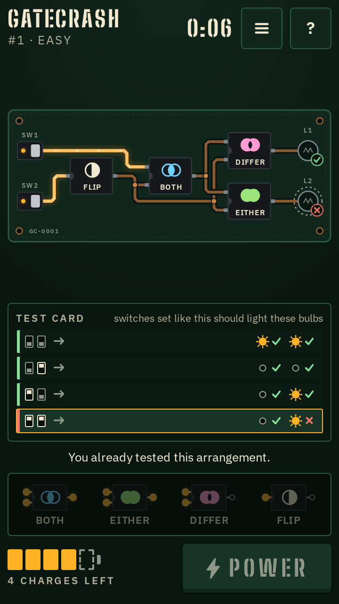
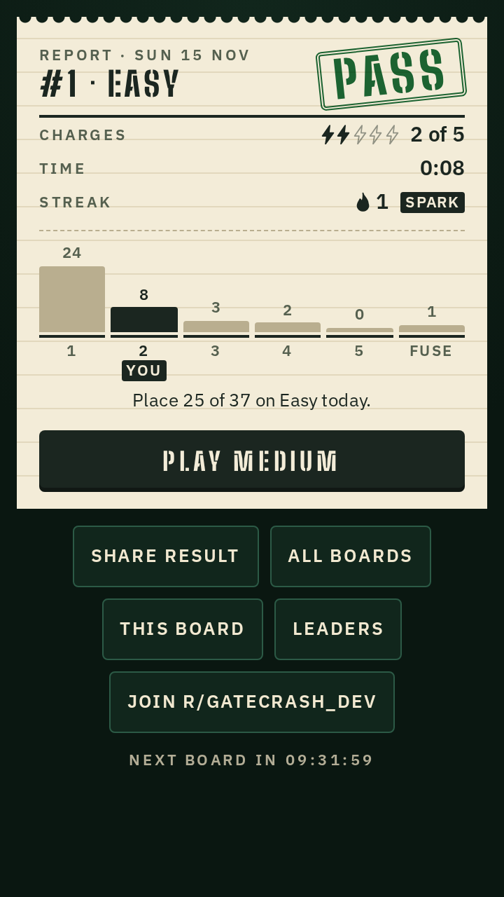

# Gatecrash

**A daily circuit puzzle for Reddit.** Every day there are three small circuit boards (easy,
medium and hard) with empty sockets. Drop the right chips into them so the bulbs light exactly as
the test card says, and do it with as few "power-ons" as you can. A board takes one to three
minutes.

Built on Devvit Web for Reddit's Game of the Day hackathon. It runs as an interactive post: a new
post appears in the community every day at midnight UTC.



## How to play

1. **Open today's post and tap Play.** First time, you get a two-chip practice board with three
   short hints. Then pick a board: Easy, Medium or Hard. You can play all three.
2. **Read the test card.** Each row shows a setting of the switches on the left and which bulbs
   should be lit for it.
3. **Seat the chips.** Drag a chip from the tray onto a socket, or tap the chip and then the
   socket. Drag a seated chip to another socket to move it, or tap it to take it back. Each chip
   has its own picture and colour, shows what it does on its own legs (wires in on the left,
   result on the right), and has a plain name:

   | Chip | What it does |
   |---|---|
   | BOTH | On only when both wires are on |
   | EITHER | On when at least one wire is on |
   | DIFFER | On when exactly one wire is on |
   | FLIP | Turns on into off, and off into on |
   | NOT BOTH | Off only when both wires are on (Sunday's hard board) |
   | NEITHER | On only when both wires are off (Sunday's hard board) |

   The pictures are two overlapping rings; the shaded part is when the chip is on.

4. **Flip the switches.** Tap a switch on the board (or a row of the card) to set the inputs.
   The board shows the signals for that setting and whether its bulbs are right, for free.
   Checking every row by hand is safe but slow, and the clock is running.
5. **Press Power** to test every row. Each press costs one of your **5 charges**. Ticks and
   crosses appear bulb by bulb; the switches stop on the first row that failed.
6. **All rows ticked: solved.** Out of charges: the fuse blows and you can look at a working
   arrangement. Either way you get a test report.

No electronics knowledge is needed, and nothing on screen uses engineering terms.

### Three boards a day

| Level | Board |
|---|---|
| Easy | 2 switches, 3–4 sockets, exactly the chips you need |
| Medium | 3 switches, 4–5 sockets, exactly the chips you need |
| Hard | 3 switches, 5–6 sockets, one or two spare chips that do not belong |
| Hard on Sundays ("Overclock") | 4 switches, 6–7 sockets, spare chips, and the NOT BOTH / NEITHER chips |

Solving any one of the day's boards keeps your streak. Each level has its own histogram and
leaderboard.

## What Reddit adds

- **One post a day** holding that day's three boards, created by the scheduler and titled
  `Gatecrash #N — Weekday`.
- **Test report** after each board: charges used, time, streak, and a histogram of how everyone
  did on that board, with your column marked.
- **Share to the thread** (optional): one tap shows the exact line, a second tap posts it from
  your account as a reply to the pinned results comment, e.g. `Gatecrash #12 Hard ⚡⚡▫▫▫ 0:48`. The line
  never contains the answer.
- **Streaks and flair**: solve at least one board on consecutive days to build a streak; your user flair in the
  community shows the tier and count (Spark, Tinkerer, Apprentice, Technician, Engineer, Wizard).
- **Leaderboards**: today, per level (fewest charges, then fastest), and longest running streaks.
- **Past boards**: every earlier day is playable from the archive. Archive plays never affect
  streaks or the day's leaderboard.
- **Join button** on the report, never during play. Sharing, joining and playing are always
  separate choices.
- **Logged-out players** can play the full board; progress is kept in the browser and the report
  offers a log-in so streaks can be saved.



## Your data

Gatecrash stores your Reddit user id and username, your attempts and times per board, and your
streak, in the app's own storage on Reddit. Nothing is sent anywhere else. **How to play → Erase
my data** deletes all of it and clears the flair the game set.

## For moderators

Install the app in a community and it posts day 1 straight away, then a new board every day at
00:00 UTC (with an hourly retry if that run fails). The subreddit menu has **Gatecrash: post
today's board** to create the post on demand. For flair and the pinned results comment the app
account needs its default moderator permissions. There are no settings to configure.

## How the daily board is made

Boards are generated, not hand-written. For each level of day *N* the server seeds a random
generator from the day number, the date, the level and a per-community salt, then:

1. builds a small layered circuit (switches → one to three columns of sockets → bulbs);
2. fills it with random chips; that is the reference answer and defines the test card;
3. adds decoy chips on harder days;
4. **rejects and retries** unless the board is fair: no bulb or wire stuck on or off, no chip that
   just passes a wire through, every switch and every socket matters, bulbs differ from each other,
   and a brute-force solver confirms there are at most 2 winning arrangements (3 on Fri–Sun) among
   at least 6 / 20 / 60 / 150 legal ones (easy / medium / hard / Overclock).

The board is stored the first time it is needed and never changes afterwards. The target is
public, so the server's job is honest counting (charges, time, streak), not secrecy: every Power
press is re-simulated on the server and the placement is checked against the tray.

## Tech notes

- **Stack:** Devvit Web 0.15, React 19, TypeScript, Vite, Hono, Redis. No game engine: the board
  is one SVG, and the animation is the copper traces themselves.
- **`src/shared`** is the engine, pure TypeScript with no platform imports: generator, simulator,
  solver, calendar, scoring, streaks. A property test checks every reject rule over 2,000
  consecutive days at all three levels.
- **`src/server`**: `app.ts` (routes), `game.ts` (rules), `store.ts` (the only Redis user),
  `reddit.ts` (the only Reddit API user). The rules are written against small port types, so the
  same code runs on Reddit, in tests and in the local harness.
- **`src/client`**: `splash.*` is the inline post, written without React so it paints immediately;
  `game.*` is the expanded game. All colours, sizes and timings come from `theme/tokens.css`.
- **Devvit Journeys** events are sent for start / progress / end. They are ignored by the platform
  until the app is allowlisted; the game does not depend on them.
- Accessibility: text contrast is at least 4.5:1; lit, wanted, right and wrong are always shown by
  shape as well as colour; controls are labelled and keyboard-operable; `prefers-reduced-motion`
  removes the travelling-signal animation and shortens the row replay.
- Fonts are self-hosted and openly licensed; see [ASSETS.md](ASSETS.md).

## Run it

Needs Node 24+.

```sh
npm install
npm run dev:local     # whole game at http://localhost:5173, no Reddit account needed
npm run check         # typecheck + lint + unit tests
npm run board -- --day 12 --count 3    # print boards as text
npm run stats -- --days 60             # difficulty spread
npm run shots         # screenshots of every screen into docs/shots, and a 360x640 fit check
```

The local harness (`tools/dev`) runs the real server routes against an in-memory Redis and a fake
Reddit. Useful paths: `/dev/as/<name>` (switch player), `/dev/as/guest` (logged out),
`/dev/advance?days=1` (next day), `/dev/seed?n=40` (fake results), `/dev/reddit` (what would have
been posted).

On Reddit:

```sh
npm run login         # once
npm run dev           # devvit playtest in your test subreddit
npm run upload        # checks, then devvit upload. Never `devvit publish` during the hackathon.
```

The app name in `devvit.json` is `gatecrash-daily`; change it if that name is taken.

More: [PLAN.md](PLAN.md) (build plan and status), [docs/platform-notes.md](docs/platform-notes.md)
(the Devvit APIs used and what still needs approval), [docs/devvit-feedback.md](docs/devvit-feedback.md).
